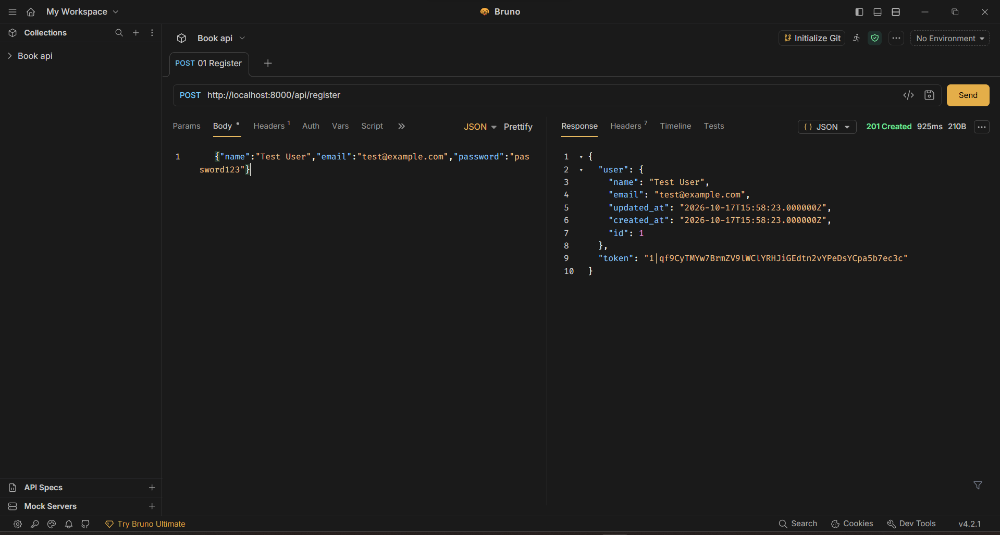
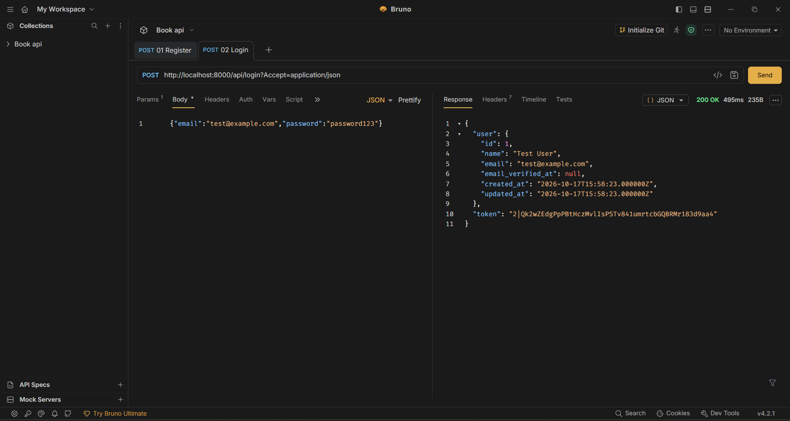
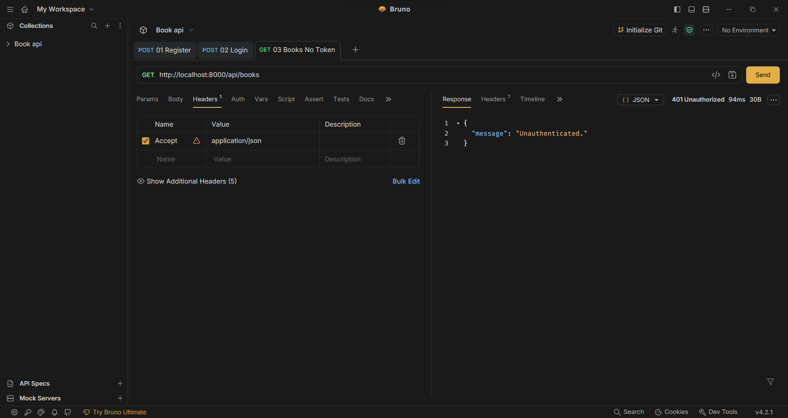
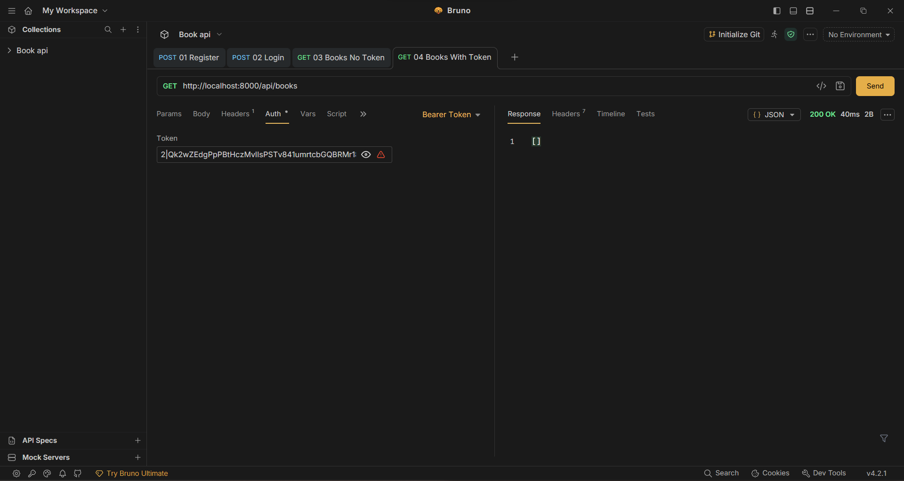
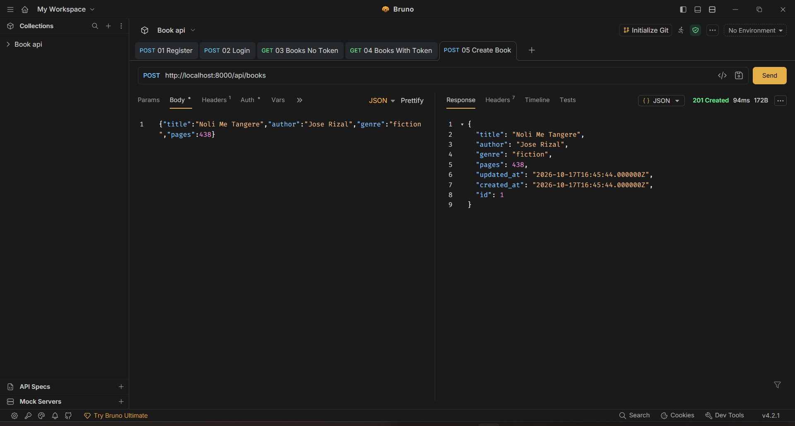
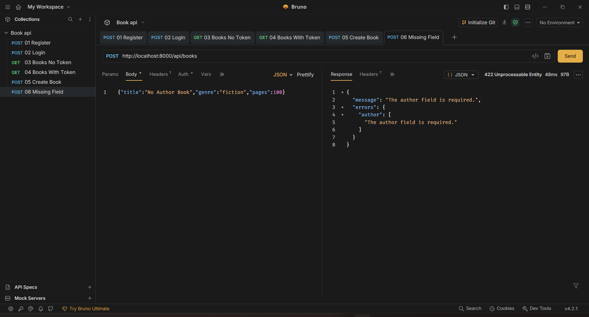
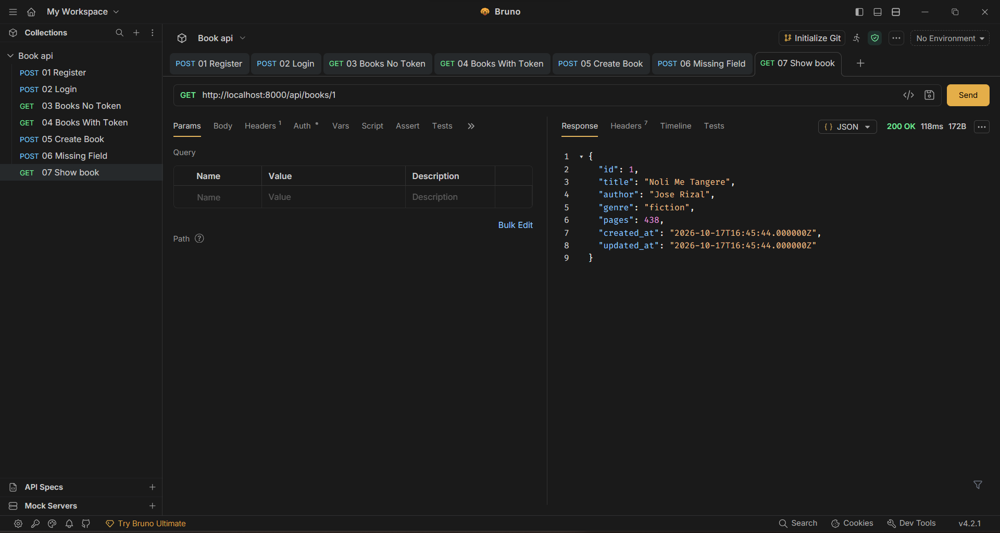
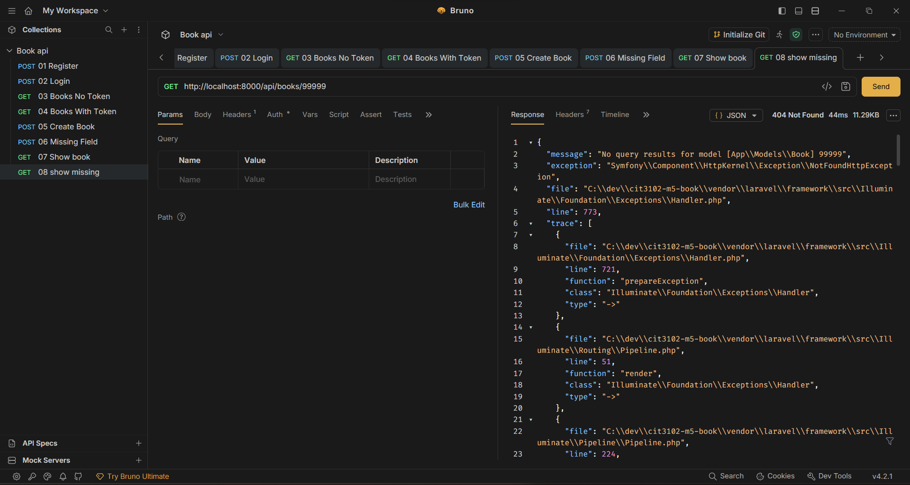
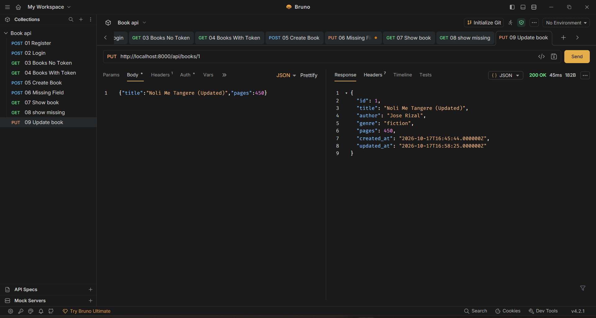
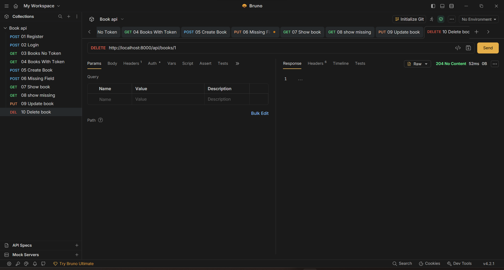

# Book API

**Partners:** [Your Name] and [Partner Name]
**Section:** [Your Section]
**Resource:** Book (fields: title, author, genre, pages)

## Setup

1. Clone the repository:
```
   git clone https://github.com/[your-username]/cit3102-m5-book.git
   cd cit3102-m5-book
```
2. Install dependencies: `composer install`
3. Create the environment file: `copy .env.example .env`
4. Generate the app key: `php artisan key:generate`
5. Create the SQLite database file: `New-Item database/database.sqlite`
6. Run the migrations: `php artisan migrate`
7. Start the server: `php artisan serve`

The API runs at `http://localhost:8000/api`. Send the header `Accept: application/json` on every request.

## Routes

| Verb | Path | What it does | Token needed |
|---|---|---|---|
| POST | /api/register | Creates a user and returns a token | No |
| POST | /api/login | Logs in and returns a token | No |
| POST | /api/logout | Deletes the current token | Yes |
| GET | /api/me | Returns the logged-in user | Yes |
| GET | /api/books | Lists books (filter by title, author, genre, pages) | Yes |
| POST | /api/books | Creates a book | Yes |
| GET | /api/books/{book} | Shows one book | Yes |
| PUT | /api/books/{book} | Updates a book | Yes |
| DELETE | /api/books/{book} | Deletes a book | Yes |

## Screenshots

1. POST /api/register (201)


2. POST /api/login (200)


3. GET /api/books with no token (401)


4. GET /api/books with the token (200)


5. POST /api/books with valid data (201)


6. POST /api/books with a missing field (422)


7. GET /api/books/1 (200)


8. GET /api/books/99999 (404)


9. PUT /api/books/1 (200)


10. DELETE /api/books/1 (204)


## Why does DELETE return 204 and not 200?

While commonly used to delete a resource and leave no representation behind, HTTP DELETE can also be used to delete a representation. A 200 status indicates success and that a response body shall be returned which is typically not the case after deletion. An HTTP 204 No Content response indicates the operation was successful, without providing any data in the response body. This prevents the confusion of a 200 response with no body, and doesn't have the semantics of “the resource is gone, nothing more to say.”